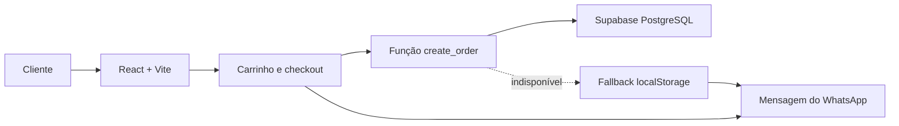

<p align="center">
  
</p>

<h1 align="center">Laura Cake — Cardápio Digital</h1>

<p align="center">
  Cardápio online responsivo com personalização de produtos, carrinho,
  checkout, registro de pedidos no Supabase e envio pelo WhatsApp.
</p>

<p align="center">
  <a href="https://react.dev/">
    
  </a>
  <a href="https://www.typescriptlang.org/">
    
  </a>
  <a href="https://vite.dev/">
    
  </a>
  <a href="https://tailwindcss.com/">
    
  </a>
  <a href="https://supabase.com/">
    
  </a>
</p>

## Sobre o projeto

O **Laura Cake — Cardápio Digital** oferece uma experiência mobile-first para
consultar o cardápio, personalizar produtos e montar pedidos. Ao finalizar, o
pedido é registrado de forma transacional no Supabase e uma mensagem completa é
preparada para envio pelo WhatsApp.

Caso o Supabase esteja temporariamente indisponível, o sistema utiliza um
fallback local para que o cliente ainda consiga concluir o pedido.

## Principais recursos

- Cardápio responsivo e otimizado para dispositivos móveis;
- categorias com disponibilidade baseada em dias e horários;
- produtos com tamanhos, sabores, recheios e opções obrigatórias;
- adicionais com preço e quantidade próprios;
- personalização específica para pastéis;
- carrinho persistente com agrupamento de itens idênticos;
- cálculo de subtotal, taxa de entrega e total;
- taxas de entrega configuráveis por bairro;
- retirada no local ou entrega;
- checkout com dados do cliente e forma de pagamento;
- geração automática da mensagem do pedido para o WhatsApp;
- registro transacional de pedidos e itens no Supabase;
- numeração diária iniciando em `#0001`, no fuso `America/Fortaleza`;
- fallback no `localStorage` quando o banco não estiver disponível.

## Tecnologias

| Camada | Tecnologia |
| --- | --- |
| Interface | React 19 |
| Linguagem | TypeScript |
| Estilos | Tailwind CSS 4 |
| Build | Vite 7 |
| Ícones | Lucide React |
| Banco de dados | PostgreSQL via Supabase |
| Integração comercial | WhatsApp |
| Hospedagem recomendada | Cloudflare Pages |

## Arquitetura



A função `create_order` registra o pedido e seus itens em uma única transação.
As tabelas não ficam diretamente expostas aos perfis públicos: o cliente recebe
permissão apenas para executar a função necessária ao checkout.

## Como executar localmente

### Pré-requisitos

- Node.js `20.19+` ou `22.12+`;
- npm;
- projeto no Supabase, caso queira persistir os pedidos no banco.

### Instalação

```bash
git clone https://github.com/Kawa-Vinicius-Dev/laura-cake-cardapio-digital.git
cd laura-cake-cardapio-digital
npm install
```

Crie o arquivo de ambiente:

```bash
cp .env.example .env
```

Preencha as variáveis:

```env
VITE_SUPABASE_URL=https://seu-projeto.supabase.co
VITE_SUPABASE_ANON_KEY=sua-chave-publica
```

Inicie o ambiente de desenvolvimento:

```bash
npm run dev
```

O Vite exibirá o endereço local, normalmente
`http://localhost:5173`.

## Configuração do Supabase

1. Crie ou abra um projeto no [Supabase](https://supabase.com/).
2. Acesse o **SQL Editor**.
3. Execute o conteúdo de [`supabase/schema.sql`](./supabase/schema.sql).
4. Em **Project Settings → API Keys**, copie a URL e a chave pública.
5. Adicione os valores ao arquivo `.env`.
6. Reinicie o servidor de desenvolvimento.

O esquema cria:

- `orders`: dados principais do pedido;
- `order_items`: produtos vinculados ao pedido;
- `order_daily_sequences`: controle atômico da numeração diária;
- índices e validações de integridade;
- políticas de Row-Level Security;
- função transacional `create_order`.

O primeiro pedido de cada nova data recebe o número `#0001`. A virada do dia
considera o fuso `America/Fortaleza`, inclusive quando o servidor está em outra
região.

## Personalização do cardápio

As principais configurações estão em
[`src/data/menu.ts`](./src/data/menu.ts):

| Configuração | Responsabilidade |
| --- | --- |
| `STORE_CONFIG` | Nome, subtítulo, WhatsApp e estimativas |
| `STORE_HOURS` | Dias e horário geral de funcionamento |
| `MENU_TIMEZONE` | Fuso utilizado nas regras de disponibilidade |
| `MENU_SCHEDULES` | Horários específicos por categoria |
| `deliveryAreas` | Bairros atendidos e taxas de entrega |
| `OTHER_DELIVERY_FEE` | Taxa aplicada aos demais bairros |
| `PASTEL_OPTIONS` | Sabores, acompanhamentos e molhos |
| `categories` | Categorias exibidas no cardápio |
| `products` | Produtos, preços, fotos, opções e adicionais |

### Produto com variações

```ts
{
  name: 'Coxinha',
  price: 7,
  optionLabel: 'Escolha o recheio',
  options: [
    { id: 'frango', name: 'Frango', price: 7 },
    { id: 'frango-catupiry', name: 'Frango com Catupiry', price: 8 },
  ],
}
```

Para produtos com variações, `price` deve conter o menor valor disponível. O
card exibe esse preço como “a partir de”, enquanto o valor da opção escolhida é
utilizado no carrinho, no Supabase e na mensagem do WhatsApp.

As imagens dos produtos ficam em
[`public/products`](./public/products). Para substituir uma imagem, adicione o
novo arquivo nessa pasta e atualize o caminho correspondente em `menu.ts`.

## Disponibilidade por horário

Categorias e produtos continuam visíveis fora do horário de atendimento, mas
ficam desabilitados e informam quando estarão disponíveis novamente.

O carrinho e o checkout também impedem a finalização caso algum produto deixe
de estar disponível depois de ser adicionado.

## Scripts disponíveis

| Comando | Descrição |
| --- | --- |
| `npm run dev` | Inicia o servidor de desenvolvimento |
| `npm run build` | Valida os tipos e gera o build de produção |
| `npm run lint` | Executa a análise estática do código |
| `npm run preview` | Visualiza localmente o build de produção |

## Estrutura do projeto

```text
.
├── public/
│   ├── products/              # Imagens dos produtos
│   └── logo-laura-cake.png    # Identidade visual
├── src/
│   ├── components/            # Componentes da interface
│   ├── data/                  # Cardápio e configurações da loja
│   ├── lib/                   # Pedidos, storage, Supabase e WhatsApp
│   ├── App.tsx                # Aplicação principal
│   └── types.ts               # Tipos compartilhados
├── supabase/
│   └── schema.sql             # Estrutura e funções do banco
├── .env.example               # Exemplo das variáveis de ambiente
└── package.json
```

## Deploy no Cloudflare Pages

Conecte o repositório ao Cloudflare Pages e utilize:

| Campo | Valor |
| --- | --- |
| Framework preset | `Vite` |
| Build command | `npm run build` |
| Build output directory | `dist` |

Cadastre no ambiente de produção:

```env
VITE_SUPABASE_URL=https://seu-projeto.supabase.co
VITE_SUPABASE_ANON_KEY=sua-chave-publica
```

Cada atualização enviada para a branch de produção gerará um novo deploy
automaticamente.

## Segurança

- Nunca envie o arquivo `.env` ao repositório;
- nunca use a chave `service_role` no frontend;
- utilize somente a chave pública do Supabase no navegador;
- mantenha o Row-Level Security habilitado;
- aplique mudanças no banco por meio de scripts SQL versionados;
- valide `npm run lint` e `npm run build` antes de publicar.

## Autor

Desenvolvido por
[Kawa Vinicius](https://github.com/Kawa-Vinicius-Dev).

